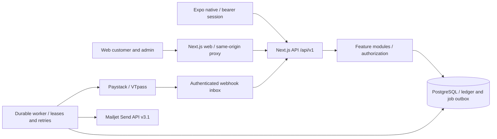

# Architecture and domain model

## Business capabilities

Quick Pay groups identity, wallet funding, payouts, bill fulfillment, gift-card review, controlled exchange capabilities, referrals and customer support into one modular monolith. The backend is a Next.js application; its worker supports durable orchestration. Frontend screens depend on API contracts rather than server actions or database imports.

## Application responsibilities

- Identity uses Better Auth password hashing, email verification, reset links, HttpOnly browser sessions, bearer sessions and TOTP. Browser calls go through the same-origin web rewrite. Auth operations remain available through HTTP for mobile.
- Bills own catalog access, current plan reads, beneficiary validation and VTpass payload translation. Payments own idempotent orchestration, persisted states and receipts.
- Ledger owns transactional account locks and immutable journal posting. Deposits are credited only after server-side provider verification; withdrawals and bills reserve before provider work.
- Rewards own structured versioned campaigns, caps, holdings, claims and refund compensation. Admin configuration appends versions and audit records.
- Gift cards own immutable quotes, expiry, private evidence, review and distinct-operator settlement. Buying and generic currency exchanges are closed until provider support exists.
- Worker claims durable PostgreSQL outbox rows with `FOR UPDATE SKIP LOCKED`, a lease token and heartbeat. Crashed external transfers are reconciled using the existing reference instead of blindly resubmitted.

## Data ownership and lifecycle

Identity owns users, sessions, hashed credentials and verification tokens. Wallet/ledger owns account buckets, journals and entries. Transactions retain request hashes, scoped idempotency and provider references. Bills owns service configuration and short-lived recipient checks. Gift cards owns products, immutable quote snapshots, encrypted evidence and sale status. Rewards reference an immutable rule version and payment. Support and notifications expose only owned resources. Audit is append-only.

UTC `timestamptz` values are used throughout. Customer dates use Africa/Lagos. Monetary database columns are `bigint` kobo; JSON uses decimal strings. No binary floating-point balance or fee calculations are used. Percentages are integer basis points and round down to a whole kobo.

Account buckets: available, reserved, rewards, reward debt and chargeback debt. Clearing, revenue and reward expense are platform accounts. Customer spendable balances cannot be negative. Verified chargebacks can create an explicit non-spendable debt and stop further spending pending support review. No admin endpoint edits a cached balance.

Journals must balance at commit. Entries cannot be updated, deleted or appended after their creating transaction commits. Cached account totals change through entry triggers only. Account locks use a deterministic order; PostgreSQL constraint failures roll back the whole operation.

## Financial lifecycle

1. Validate identity, verification, transaction password, request schema and scoped idempotency.
2. Fetch provider catalogs or validate destinations before taking ledger locks.
3. Atomically create the transaction, reserve funds and insert a durable job.
4. Commit. The worker persists external-call intent, then contacts the provider without holding a database transaction open.
5. Authenticate event delivery, enqueue verification and compare provider reference, amount, currency and destination.
6. Post final settlement/release once, or leave an uncertain outcome processing. Reversals create compensating journals and reverse related rewards.

Gift-card uploads never credit funds. Internal card review is an explicit capability requiring operating staff and business arrangements, not a fabricated gift resale API.

## Technology and deployment

Use separately deployable web/API Node services, one worker or a worker pool, managed PostgreSQL and private evidence storage on a persistent encrypted volume. The checked-in Compose file supplies local PostgreSQL. Transactional email is submitted to Mailjet by the worker over HTTPS. Production needs HTTPS, restricted database roles, durable shared private storage, backup/restore testing, monitoring and approved provider accounts. See the runbook. This is TOGAF-inspired capability/application/data/technology reasoning; no formal TOGAF compliance is claimed.

## Security controls and limits

API handlers enforce ownership and explicit permissions. Admin sessions also need verified email, TOTP enrollment and a fresh 15-minute elevation. Rate limits use PostgreSQL for application entry points; the auth implementation adds its own limits. Configure the reverse proxy to overwrite trusted client-IP headers. Browser mutation Origin checks and Better Auth origin/CSRF protections remain active. Only the signature-authenticated Paystack webhook bypasses browser CSRF.

Evidence is size limited, magic-byte checked, encrypted with AES-256-GCM, stored outside public assets, quarantined and served as an attachment with ownership/reviewer authorization. A real malware scanner and retention job are external launch requirements. Server logs record correlation IDs, event types and identifiers without raw provider payloads or secrets.

## Native customer client

`apps/mobile` is an Expo Router / React Native TypeScript application. Thin route files compose feature-owned screens. NativeWind provides the five existing brand colors and native controls, Reanimated/Gesture Handler provide reduced-motion-aware transitions and sheets, and TanStack Query owns server state. It imports browser-safe `@quickpay/contracts` (validation, exact kobo formatting, public response types) and the extended `@quickpay/api-client` transport factory. Database clients, provider credentials and server modules are never imported into the mobile graph.

SecureStore holds signed bearer sessions, official Better Auth Expo MFA cookies and bounded recovery/quote drafts. Sliding session renewal is single-flight; account changes/logout clear private query data. Money mutations are never automatically queued offline. Original idempotency key/body are persisted without password before submission and recovered through an ownership-scoped lookup. Push and payment links trigger reads of current state.

The existing API gained read-only wallet capabilities and operation recovery plus ownership-scoped push devices/preferences. A PostgreSQL notification outbox trigger queues generic push work onto the existing worker, with receipts and token revocation. Migration 0010 adds only notification-related tables/trigger. No wallet, journal, reward-rule, provider settlement or user database is duplicated. Existing limits moved to a module constant shared by reads and command validation without changing values.
